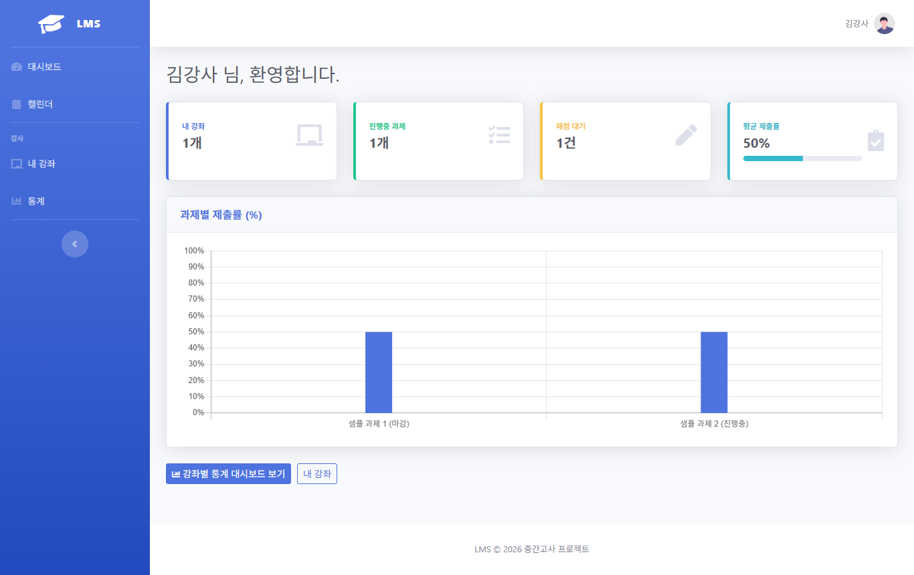
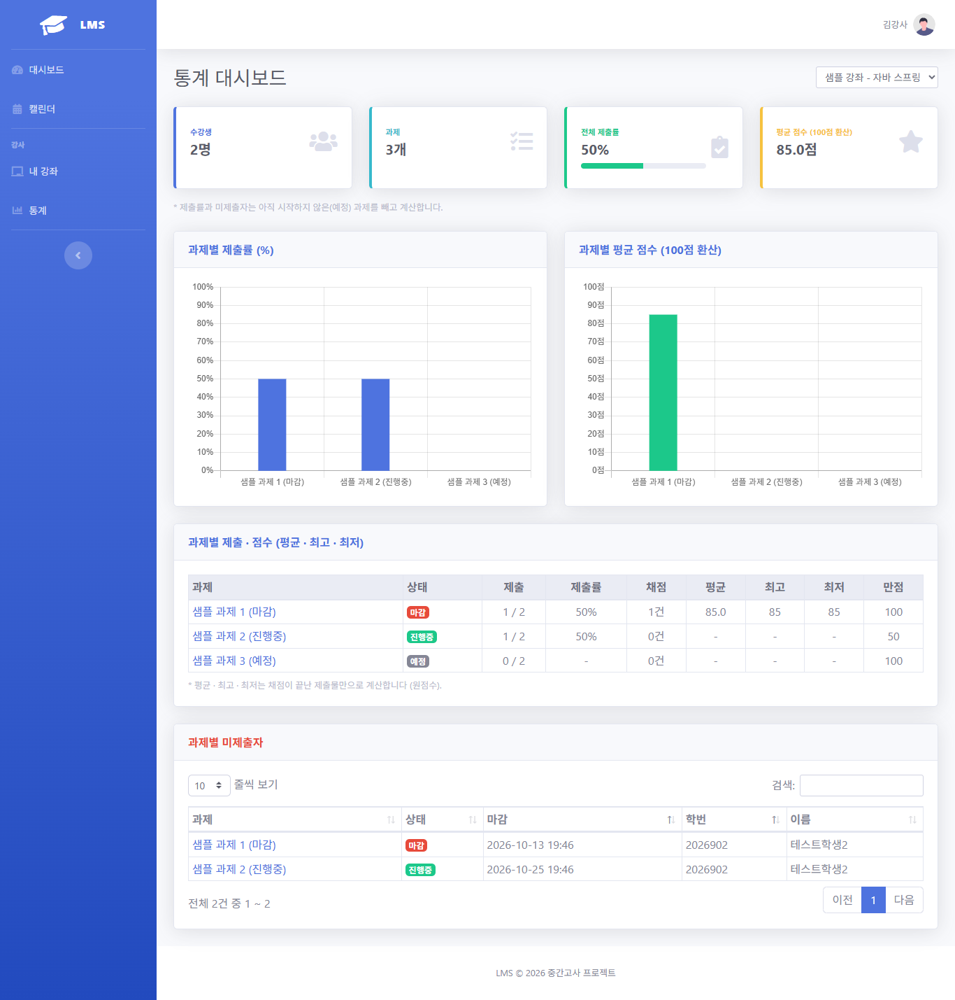
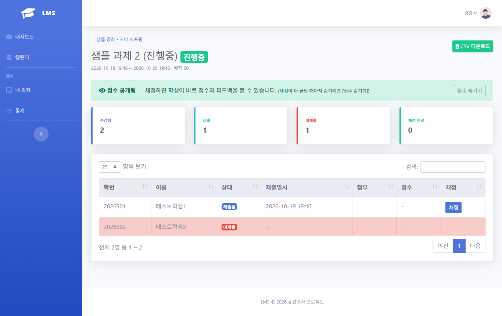
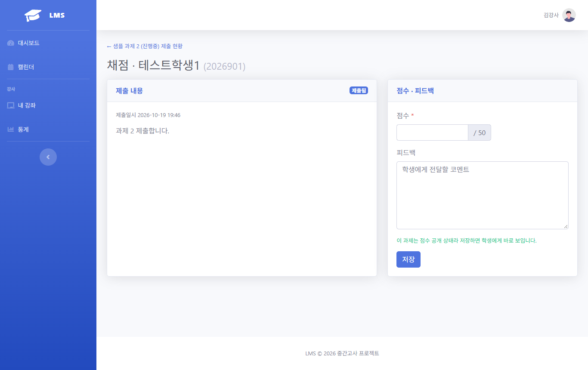
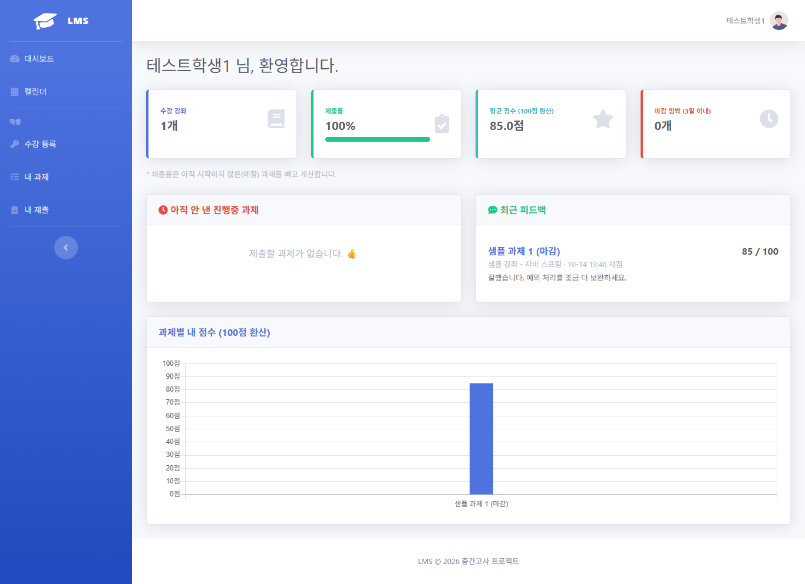
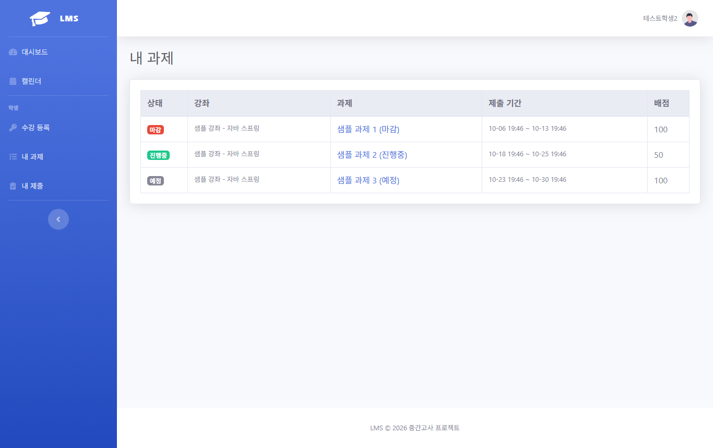
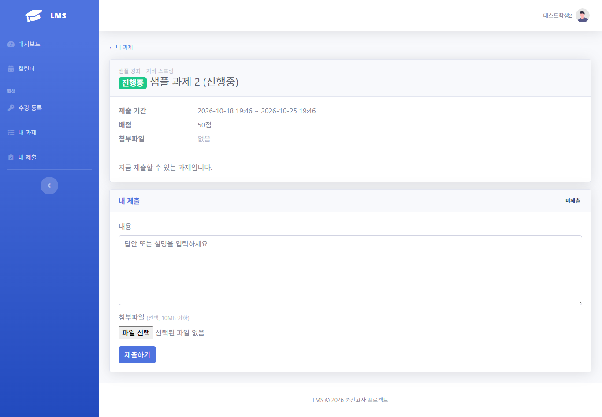
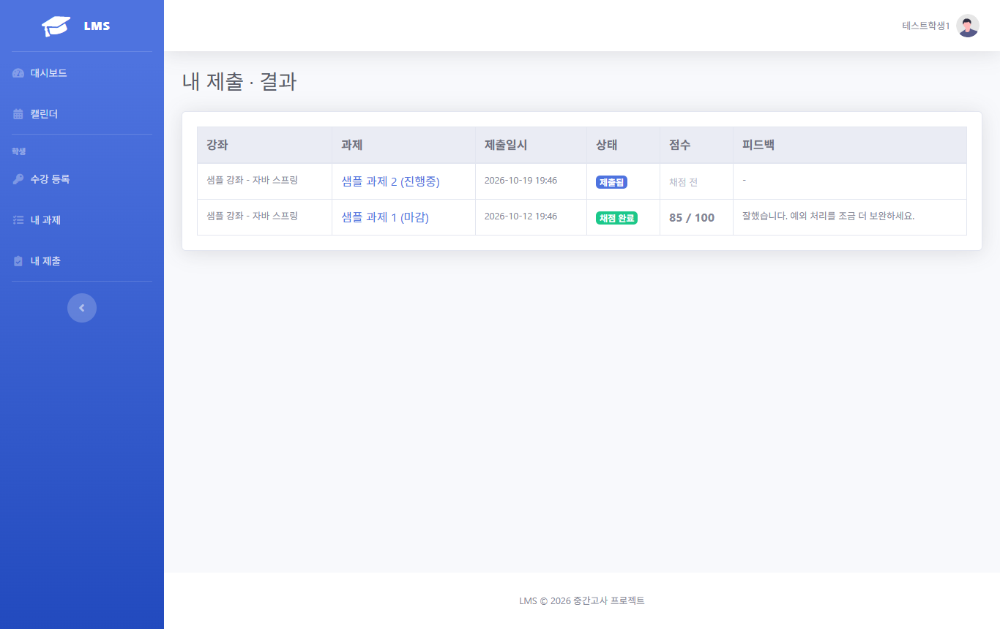

# LMS — 과제 제출·채점 관리 시스템

강사는 강좌를 개설하고 과제를 내고 채점하며, 학생은 참여코드로 수강 등록 후 기간 안에 과제를 제출하고 결과를 확인하는 **학습 관리 시스템(LMS)** 입니다.
REST API 대신 **서버 렌더링(Controller → Model → Thymeleaf)** 으로 만들었습니다.

## 기술 스택

| 구분 | 사용 기술 |
|---|---|
| 백엔드 | Spring Boot 3.5 · Java 17 · Spring Data JPA |
| DB | H2 (파일 모드, 재시작해도 유지) |
| 인증 | Spring Security 6 · 세션 기반 폼 로그인 · BCrypt |
| 화면 | Thymeleaf · Layout Dialect · thymeleaf-extras-springsecurity6 |
| UI 템플릿 | SB Admin 2 (Bootstrap 4.6 · jQuery · Font Awesome 5) |
| 차트·표 | Chart.js 2.9 · DataTables |
| 테스트 | JUnit 5 · AssertJ · `@DataJpaTest` |

---

## 실행 방법

**필요한 것:** JDK 17 이상 아무 버전 (Gradle 실행용). 프로젝트가 쓰는 JDK 17 이 없으면 Gradle 이 자동으로 내려받습니다.

```bash
./gradlew bootRun
```
또는 IntelliJ 에서 `LmsApplication` 실행 → 브라우저에서 **http://localhost:8080**

- DB 는 H2 **파일** 모드라서 서버를 재시작해도 데이터가 남습니다. (`data/lmsdb.mv.db`, Git 제외)
  처음부터 다시 하려면 서버를 끄고 `data/` 폴더를 지운 뒤 실행하세요. (테스트 계정·샘플 데이터는 `data.sql` 이 다시 만듦)
- 테스트 데이터: `src/main/resources/data.sql` — 서버를 켤 때마다 실행되지만 **이미 있는 데이터는 건너뜁니다** (중복 없음, 바꾼 비밀번호 유지)
- 업로드 파일은 프로젝트 폴더의 `uploads/` 에 저장됩니다. (Git 제외)
- DB 확인 (H2 콘솔): 보안상 **기본은 꺼져 있습니다.** 내 PC 에서만 실행 옵션에 `--spring.h2.console.enabled=true` 를 붙이고
  http://localhost:8080/h2-console (JDBC URL `jdbc:h2:file:./data/lmsdb`, User `sa`)

### 제출용 jar 만들기 · 배포

```bash
./gradlew bootJar
```
→ `build/libs/lms.jar` 하나가 제출 파일입니다. (코드·화면·라이브러리·내장 톰캣 포함, 약 70MB)

```bash
java -jar lms.jar
```
- **Java 17 이상** 필요
- 포트: `--server.port=8081` 옵션, `SERVER_PORT` 또는 `PORT` 환경변수 중 하나로 지정 (없으면 8080)
- 서브도메인(리버스 프록시) 뒤에서도 로그인·리다이렉트가 원래 주소로 동작 (`server.forward-headers-strategy: framework`)
- jar 를 실행한 폴더에 `data/`(DB), `uploads/`(첨부파일) 가 만들어집니다
- ⚠️ 테스트 강사 비밀번호가 공개되어 있으므로, **배포 직후 강사로 로그인해 "내 정보 → 비밀번호 변경"** 을 해 두세요 (파일 DB 라 재시작해도 유지)

### 테스트 계정

| 역할 | 이메일 | 비밀번호 | 비고 |
|---|---|---|---|
| 강사 | `instructor1@lms.com` (김강사) | `instructor1234` | 샘플 강좌 담당 |
| 강사 | `instructor2@lms.com` (이강사) | `instructor1234` | 강좌 없음 → 남의 강좌 접근(B5) 시험용 |
| 학생 | `student1@lms.com` (테스트학생1, 2026901) | `student1234` | 과제 1 채점 완료(85점), 과제 2 제출(채점 대기) |
| 학생 | `student2@lms.com` (테스트학생2, 2026902) | `student1234` | 아직 제출 없음 → 미제출자로 표시 |

**샘플 데이터 (`data.sql`)**: 강좌 "샘플 강좌 - 자바 스프링" (참여코드 `SAMPLE26`) 에 학생 2명이 등록되어 있고,
과제는 처음 실행한 시각 기준으로 **마감 · 진행중 · 예정** 이 하나씩 만들어집니다. 새 학생은 회원가입 후 `SAMPLE26` 으로 수강 등록하면 됩니다.

> 강사 계정은 회원가입이 불가능하고 `data.sql` 로만 만들어집니다. (U4) 개발용 테스트 계정입니다.

---

## 요구사항 구현

**요구사항 ID 16개 모두 완료** (✅ 완료 16 · 일부 0 · 미완료 0). 각 항목은 아래 "테스트"의 통합 점검으로 확인했습니다.

### 공통
| ID | 기능 | 상태 | 구현 |
|---|---|:---:|---|
| U1 | 학생 회원가입 | ✅ 완료 | 학번·이름·이메일·비밀번호, 형식 검증 + 이메일/학번 중복 검사, BCrypt 암호화 |
| U2 | 로그인·로그아웃 | ✅ 완료 | Spring Security 폼 로그인 (이메일), 로그아웃은 POST (CSRF) |
| U3 | 역할별 메뉴 | ✅ 완료 | `sec:authorize` 로 강사/학생 사이드바 분리, URL 권한은 SecurityConfig |
| U4 | 강사 계정 | ✅ 완료 | `data.sql` 초기 데이터 (가입 불가) |

### 강사
| ID | 기능 | 상태 | 구현 |
|---|---|:---:|---|
| I1 | 강좌 개설 | ✅ 완료 | 참여코드 8자리 자동 발급 (`SecureRandom`, 헷갈리는 `0 O 1 I` 제외, 중복 확인) |
| I2 | 수강생 목록 | ✅ 완료 | 강좌 상세에서 학번·이름·이메일·등록일 |
| I3 | 과제 등록·수정·삭제 | ✅ 완료 | 시작/종료일시 · 배점 · 첨부파일 1개 (UUID 저장, 10MB 제한) |
| I4 | 제출 현황 | ✅ 완료 | 과제별 제출/미제출 표 + 요약 카드, DataTables 검색·정렬 |
| I5 | 채점·피드백 | ✅ 완료 | 점수 + 코멘트, 재채점 가능 |
| I6 | 통계 대시보드 | ✅ 완료 | 강좌 선택, 수강생·과제·제출률·평균 카드, Chart.js 차트 2개, 과제별 평균·최고·최저 표, 미제출자 DataTables. 강사 홈: 강좌·진행중 과제·채점 대기·평균 제출률 카드 + 과제별 제출률 차트 |

### 학생
| ID | 기능 | 상태 | 구현 |
|---|---|:---:|---|
| S1 | 수강 등록 | ✅ 완료 | 참여코드 입력 (대소문자·앞뒤 공백 무시) |
| S2 | 내 과제 목록 | ✅ 완료 | 예정/진행중/마감 배지 (저장하지 않고 시간으로 계산) |
| S3 | 과제 제출·재제출 | ✅ 완료 | 기간 안에서만, 내용 + 파일 첨부, 재제출은 덮어쓰기 |
| S4 | 결과 확인 | ✅ 완료 | 점수 / 배점, 피드백 |
| S5 | 내 통계 | ✅ 완료 | 제출률, 평균 점수(100점 환산), 마감 임박(3일 이내) 목록, 점수 차트 |

### 추가 기능
| 기능 | 구현 |
|---|---|
| DB 유지 | H2 파일 모드 (`ddl-auto: update`), 재시작해도 데이터 유지 |
| 내 정보 · 비밀번호 변경 | `/me` — 이름 변경(세션 로그인 정보 즉시 갱신), 현재 비밀번호 확인 후 변경 (현재와 같은 비밀번호 불가) |
| 강좌 수정 · 삭제 | 강좌명·설명 수정, **수강생이나 과제가 있으면 삭제 불가** (B8 과 같은 방식), B5 본인 강좌만 |
| 참여코드 재발급 | 코드 유출 시 새 코드로 교체 (이미 등록한 학생은 유지, 옛 코드로는 등록 불가) |
| 강좌 카드 색 | 강좌 번호로 색을 정해 강사·학생 화면에서 같은 색 (학교 LMS 참고, DB 변경 없음) |
| 최근 피드백 | 학생 대시보드에 최근 채점된 과제 3개 (점수 + 피드백) |
| 학생 강좌 홈 + 내 성적 | `/student/courses/{id}` — 이 강좌 과제와 내 제출 상태, 성적표 합계. **"평가된 과제에만 근거한 계산"** 체크 (해제 시 미제출·채점 전 0점), B2 수강생만 |
| 점수 숨기기 (평가 중) | 기본은 채점하면 바로 공개 (S4 그대로). 강사가 과제별 **[점수 숨기기]** 를 누르면 학생에게 "평가 중" (점수·피드백·합계·평균에서 제외), [점수 공개] 로 되돌림. **B4 는 숨김 상태에도 적용** |
| 마감 캘린더 | `/calendar` — 월 달력에 과제 마감일 (라이브러리 없이 직접 구현). 강사 = 내 강좌, 학생 = 수강 강좌 + 제출한 과제 ✓, ● 강좌 색 |
| 성적 CSV 다운로드 | 제출 현황 → 학번·이름·상태·점수·피드백 CSV. UTF-8 BOM(엑셀 한글), 쉼표·따옴표·줄바꿈 처리, **CSV 인젝션 방지** |

---

## 핵심 비즈니스 규칙

> 화면에서 막는 것은 "편의", 서버에서 막는 것은 "보안".
> **모든 규칙은 Service 에서 검사**하고, 필요한 곳은 화면에서도 미리 막았습니다.

| # | 규칙 | 서버 검사 위치 | 위반 시 |
|---|---|---|---|
| B1 | 제출은 시작일시 ≤ 현재 ≤ 종료일시 일 때만 | `Assignment.isSubmittable()` → `SubmissionService.submit` | "제출 기간이 아닙니다" 알림 (화면은 입력칸 비활성화) |
| B2 | 수강 등록된 학생만 과제 열람·제출 | `AssignmentService.getForStudent` | 403 |
| B3 | 과제당 학생 1건, 재제출은 덮어쓰기 | DB unique (assignment, student) + `Submission.resubmit()` | 기존 제출 수정 |
| B4 | 채점 완료(GRADED) 제출은 재제출 불가 | `SubmissionService.submit` | "채점 완료된 과제" 알림 |
| B5 | 강사는 본인 강좌의 과제만 수정·삭제·채점 | `Course.isOwnedBy()` → `getMyCourse` / `getMyAssignment` / `getForGrading` | 403 |
| B6 | 점수는 0 이상 배점 이하 | `SubmissionService.grade` (배점이 과제마다 달라 Service 에서) | 폼 에러 |
| B7 | 종료일시는 시작일시보다 뒤 | `AssignmentService.validatePeriod` | 폼 에러 |
| B8 | 제출이 1건이라도 있는 과제는 삭제 불가 | `AssignmentService.delete` | "제출물이 있어 삭제 불가" 알림 |

### 경계값 정책

| 항목 | 정책 |
|---|---|
| 기준 시각 | **서버 시각** (`LocalDateTime.now()`). 브라우저 시각은 쓰지 않음 |
| 입력 단위 | 시작·종료일시는 `datetime-local` 로 **분 단위** 입력 → 초는 `00` 으로 저장 |
| 시작 경계 | `현재 < startAt` 이면 예정 → 시작 시각 **정각부터 제출 가능** (포함) |
| 종료 경계 | `현재 > endAt` 이면 마감 → 종료 시각 **정각(hh:mm:00)까지 제출 가능** (포함), 그 1초 뒤부터 거부 |
| 배지 · 제출 가능 | 같은 메서드(`Assignment.getStatus()`)로 계산 → 화면 배지와 서버 검사가 항상 일치 |
| B6 점수 | `0` 과 `배점` 모두 허용 (포함), 음수·배점 초과·소수·문자는 폼 에러 |
| B7 기간 | 종료 = 시작 은 **거부** (종료가 시작보다 뒤여야 함) |
| 배점 | 1 ~ 1000 |
| 마감 임박 (S5) | 남은 시간 24시간 이내는 "N시간 / N분 남음", 그 외는 **날짜** 차이로 `D-N` (시각 차이로 세면 하루 적게 나와서). 3일 이내 과제만 표시 |

오류 표시 방식은 두 가지 예외로 나눴습니다.
- `FieldValidationException` → 해당 **입력칸 아래** 에러 (B6, B7, 회원가입 중복 등)
- `BusinessRuleException` → 화면 위 **알림** (B1, B4, B8)

---

## 통계 항목 정의

모든 통계는 **저장하지 않고 조회할 때 계산**합니다. 과제별 제출 수·채점 수·평균·최고·최저는 JPQL `group by` 한 번으로 구합니다 (`SubmissionRepository.countByAssignmentInCourse`).

| 항목 | 계산식 | 비고 |
|---|---|---|
| 과제별 제출률 | 제출 건수 ÷ 수강생 수 × 100 (반올림) | 수강생 0명이면 0% |
| 강좌 전체 제출률 | 시작된 과제들의 제출 건수 합 ÷ (수강생 수 × 시작된 과제 수) × 100 | **예정 과제는 제외** (아직 낼 수 없으므로) |
| 강사 홈 평균 제출률 | 내 모든 강좌의 (시작된 과제 제출 건수 합) ÷ (수강생 수 × 시작된 과제 수의 합) × 100 | 시작된 과제가 없으면 `-` |
| 진행중 과제 | `startAt ≤ 현재 ≤ endAt` 인 내 강좌 과제 수 | |
| 채점 대기 | 상태가 SUBMITTED 인 제출 건수 | |
| 과제별 평균 · 최고 · 최저 | 채점된 제출물 score 의 `avg` · `max` · `min` (원점수) | 채점 전(null) 제외, 채점 0건이면 `-` |
| 평균 점수 (100점 환산) | 과제별 평균 ÷ 배점 × 100, 강좌 전체는 채점 건수로 가중평균 | 배점이 과제마다 달라서 환산 |
| 미제출자 | 수강생 중 그 과제에 제출이 없는 학생 | 예정 과제는 제외 |
| 학생 제출률 (S5) | 내가 제출한 과제 수 ÷ 시작된 과제 수 × 100 | 수강 중인 모든 강좌 |
| 학생 평균 점수 (S5) | 점수가 공개된 채점 결과의 100점 환산 평균 | 점수 숨김 과제 제외 |

---

## 화면 캡처

`docs/screens/` (샘플 데이터 기준)

| 강사 대시보드 | 통계 대시보드 |
|---|---|
|  |  |
| **제출 현황 (I4)** | **채점 (I5)** |
|  |  |
| **학생 대시보드 (S5)** | **내 과제 목록 (S2)** |
|  |  |
| **과제 제출 (S3)** | **내 제출 · 점수 (S4)** |
|  |  |

그 밖에: [로그인](docs/screens/01-login.png) · [강좌 상세](docs/screens/03-instructor-course-detail.png) · [캘린더](docs/screens/11-calendar.png)

---

## 화면 / URL

| 역할 | URL | 화면 |
|---|---|---|
| 공통 | `/login` · `/signup` | 로그인 · 학생 회원가입 |
| 공통 | `/` | 역할별 대시보드 (강사: 요약 카드 / 학생: S5 내 통계) |
| 공통 | `/me` | 내 정보 · 비밀번호 변경 (추가 기능) |
| 공통 | `/calendar?month=2026-10` | 마감 캘린더 (추가 기능) |
| 강사 | `/instructor/courses` · `/new` · `/{id}` | 내 강좌 · 개설 · 상세(참여코드, 과제, 수강생) |
| 강사 | `/instructor/courses/{id}/edit` | 강좌 수정 · 삭제, 참여코드 재발급 (추가 기능) |
| 강사 | `/instructor/assignments/new` · `/{id}/edit` | 과제 등록 · 수정/삭제 |
| 강사 | `/instructor/assignments/{id}/submissions` | 제출 현황 + 미제출자 (`.csv` 다운로드) |
| 강사 | `/instructor/submissions/{id}/grade` | 채점 · 피드백 |
| 강사 | `/instructor/stats` | 통계 대시보드 |
| 학생 | `/student/courses/join` | 참여코드 입력 + 수강 중인 강좌 |
| 학생 | `/student/courses/{id}` | 강좌 홈: 과제 + 내 성적 (추가 기능) |
| 학생 | `/student/assignments` · `/{id}` | 내 과제 목록 · 상세 + 제출 |
| 학생 | `/student/submissions` | 내 제출 · 점수 · 피드백 |
| 공통 | `/assignments/{id}/file` · `/submissions/{id}/file` | 첨부 다운로드 (권한 검사) |
| 공통 | `error/403` · `error/404` · `error` | 권한 없음 · 없는 페이지 · 그 외 오류 |

---

## 설계

- **ERD:** [`docs/erd.png`](docs/erd.png) · [`docs/erd.md`](docs/erd.md) — USERS · COURSE · ENROLLMENT · ASSIGNMENT · SUBMISSION

#### 예시 ERD 와 다른 칸 (관계 · 필수 칸은 그대로, 이름 변경 · 추가한 칸과 이유)

| 테이블 | 예시 ERD | 이 프로젝트 | 이유 |
|---|---|---|---|
| COURSE | `name` | `title` | 과제(`ASSIGNMENT.title`)와 같은 이름으로 통일 (W1 설계 때 정함) |
| ENROLLMENT | `joined_at` | `enrolled_at` | 엔티티 이름(Enrollment)에 맞춤 |
| ASSIGNMENT · SUBMISSION | `file_path` | `file_stored_name` + **추가** `file_original_name` | 서버에는 UUID 이름으로 저장(같은 이름 덮어쓰기 · 경로 조작 방지), 다운로드할 때는 원래 이름으로 주려고 둘 다 저장 |
| ASSIGNMENT | — | **추가** `scores_published` | 추가 기능 "점수 숨기기" (기본 true = 채점하면 바로 공개) |

- **프로젝트 맥락 (AI 요청용):** [`docs/context.md`](docs/context.md) — 버전, 패키지 구조, 규칙, 화면 맵
- **저장하지 않고 계산하는 값:** 과제 배지, 미제출자, 제출률, 평균 점수
- 파일은 디스크에, DB 에는 원래 이름 + 저장 이름(UUID) 만 저장

### 프로젝트 구조

```
src/main/java/com/ync/lms
├─ config/        SecurityConfig
├─ security/      LoginUser, CustomUserDetailsService
├─ domain/        User, Course, Enrollment, Assignment, Submission (+ 상태 enum)
├─ repository/    Spring Data JPA (I6 통계는 group by @Query)
├─ service/       비즈니스 규칙 B1~B8, 파일 저장, 통계
├─ dto/           폼 입력 객체 (Entity 를 폼에 직접 쓰지 않음)
├─ exception/     FieldValidationException, BusinessRuleException, NotFoundException
└─ controller/    강사/학생/공통 컨트롤러, 공통 예외 처리

src/main/resources
├─ static/        SB Admin 2 (필요한 파일만)
├─ templates/     layout/ · fragments/ · auth/ · instructor/ · student/ · error/
└─ data.sql       테스트 데이터 (강사 2 · 학생 2 · 샘플 강좌)
```

---

## 테스트

```bash
./gradlew test
```

| 테스트 | 확인하는 것 |
|---|---|
| `FileStorageServiceTest` (7) | UUID 저장, 같은 이름 덮어쓰기 방지, 경로 조작(`../`) 차단, 삭제 |
| `SubmissionRepositoryTest` (2) | I6 group by 쿼리: 제출 수, 채점 수, 평균·최고·최저(채점 전 null 제외), 다른 강좌 미포함 |
| `CsvWriterTest` (7) | 쉼표·따옴표·줄바꿈 처리, `=` `+` `-` `@` 수식 실행 방지, BOM, CRLF |
| `LmsApplicationTests` (1) | 애플리케이션 시작 |

이 외에 요구사항 ID 와 B1~B8 을 처음부터 끝까지 확인하는 **통합 점검 60개 항목**을 실제 서버에 요청을 보내는 방식으로 수행했습니다. (강사2의 남의 강좌 접근, 개발자도구로 막힌 버튼을 우회한 강제 제출 등 포함)

---

## AI 활용

- **도구:** Claude (Claude Code) — 요구사항 ID 하나씩 작게 요청하고, 공통 맥락은 [`docs/context.md`](docs/context.md) 로 정리
- **검증:** 생성된 코드를 읽기 → 실행 → 경계값으로 깨뜨려 보기 → 테스트 → 커밋. 과정은 [`docs/prompt-log.md`](docs/prompt-log.md) 에 20건 기록 (주차별 3건 이상, 주차마다 AI 오류 수정 사례 포함)

### AI 가 틀려서 고친 사례 Best 3

| # | 상황 | 원인 | 고친 방법 |
|---|---|---|---|
| 1 | **B6** 배점보다 큰 점수로 채점하면 에러 메시지 대신 **500 오류** | 예외로 트랜잭션이 롤백된 뒤, 분리된 엔티티의 LAZY 필드(강좌)를 화면에서 읽음 | 실패 시 컨트롤러에서 **다시 조회**해서 폼을 보여주도록 수정. 같은 구조였던 과제 수정 화면도 함께 수정 |
| 2 | 배포용으로 H2 콘솔을 끄자 **모든 화면이 500** | SecurityConfig 가 꺼진 H2 콘솔 설정 빈을 항상 참조 | H2 콘솔 보안 규칙을 **켜져 있을 때만** 등록하도록 조건 처리 |
| 3 | 회원가입 빈칸 제출 시 한 칸에 **메시지가 2줄** (학번에서 고쳤는데 비밀번호에서 재발) | 빈 값이 `@NotBlank` 와 `@Size` 에 동시에 걸림 | `@NotNull` + `@Size` 로 메시지 1개만. **재발 방지로 "한 칸에 2줄인 곳 0개" 점검 항목 추가** |

---

## 알려진 제한

- H2 파일 DB 사용 (MySQL 전환은 선택 사항, 미적용)
- 첨부파일은 과제·제출물마다 1개
- 수강 취소 기능 없음
